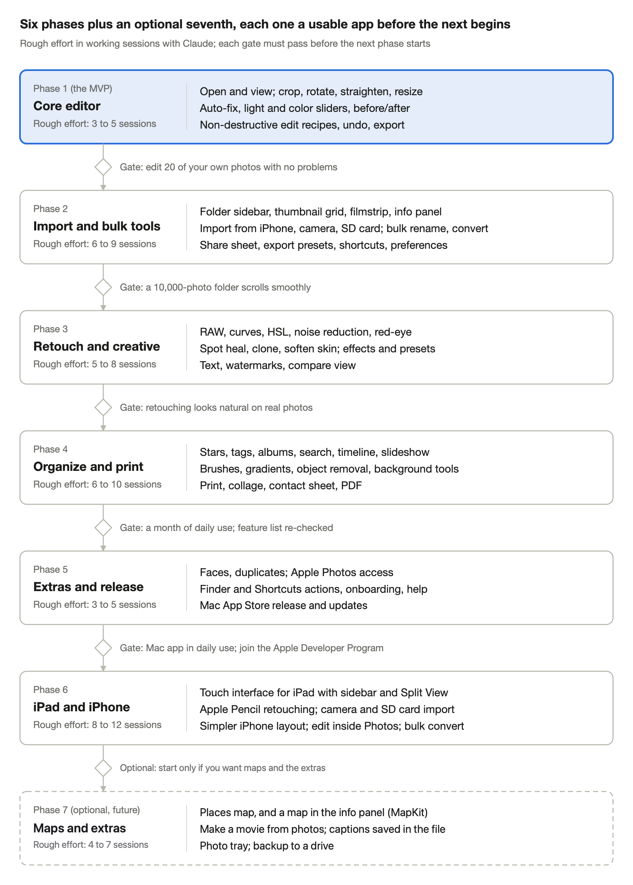

# Fotolark — Full Version Plan

As of Nov 6, 2026. The live, editable version of this plan is the Claude Doc:
https://claude.ai/artifact/C4sZy2hHauiyKFhUyMas6H — update both when the plan changes.

## Vision and principles

Fotolark is a native photo editor for Mac (and later iPad and iPhone) that brings back what made Picasa loved. You point it at your folders, see every photo at once and fix one in seconds, without importing anything or learning a pro tool. The full version adds batch work, retouching, organization and sharing, but the first screen should stay as simple as the MVP.

- **Your folders, not a library.** Photos stay where they are in Finder. There is no import step and no proprietary database you can get locked into.
- **Never ruin an original.** Every edit is a recipe that is stored beside the photo and replayed on screen. A file is only written when you export or choose to save over it.
- **One click first, sliders second.** Every panel opens with an automatic button (Auto-fix, Auto-straighten, Auto-crop). Fine controls sit one level down.
- **Fast.** Thumbnails appear right away and slider changes show in under 50 ms on a 24 MP photo, using Core Image on the GPU.
- **A real Mac app.** Standard menus, keyboard shortcuts, drag and drop, dark mode, Undo, and Share sheet support. It should feel like Apple made it.

## Tech stack and architecture

The app will be built in Swift with SwiftUI, on Apple's own frameworks only. That means no paid libraries, no subscriptions and a small app download.

| Layer | Apple technology | What it does here |
| --- | --- | --- |
| Interface | SwiftUI (AppKit where needed) | Windows, sidebar, grid, inspector panels, menus |
| Image engine | Core Image + Metal | All adjustments and filters, live and on the GPU |
| File input/output | ImageIO, UniformTypeIdentifiers | Reads and writes JPEG, PNG, HEIC, TIFF, WebP and RAW, and keeps EXIF metadata |
| RAW decoding | CIRAWFilter | Camera RAW files from most cameras |
| Device import | ImageCaptureCore | Finds plugged-in iPhones, iPads and cameras, lists their photos, copies and optionally deletes them |
| Bulk jobs | Swift concurrency (task groups) | Runs conversions and renames in parallel across all CPU cores |
| Smart features | Vision framework | Face detection, horizon detection, subject lift, text recognition |
| Folder watching | FSEvents / DispatchSource | Updates the grid when files change in Finder |
| Thumbnail cache | QuickLookThumbnailing + an on-disk cache | Opens folders of 10,000+ photos quickly |
| Catalog | SwiftData (SQLite) | Tags, stars, albums, faces and search index |
| Sharing | NSSharingServicePicker | Mail, Messages, AirDrop, Photos, Notes |
| Printing | NSPrintOperation | Prints and contact sheets |

**How edits are stored:** each photo's edits live in an *edit recipe*, an ordered list of operations such as crop, rotate, exposure +0.3 or retouch spot. Recipes are saved as small JSON sidecar files beside each photo (decided Nov 6, 2026; a catalog option can be added in Preferences). The sandbox only grants access to the one photo opened from Finder, so the app declares sidecars as related files (`NSIsRelatedItemType`) to be allowed to write them, and falls back to the catalog if that fails. On screen the recipe runs through Core Image. Export writes a new file. This gives unlimited undo, copy and paste of edits between photos, and an always-safe original.

**Shared engine for Mac, iPad and iPhone:** from day one, the code is split into two parts. A shared *FotolarkKit* package holds edit recipes, Core Image filters, file input/output, bulk jobs and Vision features. A thin interface layer is written separately for each device. Nearly all of these Apple frameworks also exist on iPadOS and iOS, so Phase 6 is mostly new screens, not new editing code. The exceptions are folder watching, Finder integration and Quick Look Services, which are Mac-only.

**Distribution:** the minimum is macOS 14 Sonoma, and iPadOS 17 / iOS 17 for Phase 6. The app runs on both Apple silicon and Intel (tested on a family Intel Mac) and is sandboxed and released through the Mac App Store, which also delivers updates (decided Nov 6, 2026).

## Full feature list

The full version has 109 features in 11 areas. The Phase column shows which release adds each one (phases are described in the next section).

### 1. Browsing and viewing

| Feature | What it does | Phase |
| --- | --- | --- |
| Folder sidebar | Choose which Mac folders to watch; shows every folder that holds photos, with counts | 2 |
| Thumbnail grid | Fast, scrollable grid with a size slider; sort by date, name or size | 2 |
| Timeline view | All photos grouped by year and month, from EXIF dates | 4 |
| Single-photo viewer | Full-screen view, arrow keys for next and previous, pinch and scroll to zoom | 1 |
| Filmstrip | Thumbnail strip under the editor for quick switching | 2 |
| Compare view | Two to four photos side by side with linked zoom | 3 |
| Slideshow | Full-screen slideshow with timing, transitions and optional music | 4 |
| Info panel | Camera, lens, exposure, date, size and GPS coordinates (map view in Phase 7) | 2 |
| Live update | New, renamed or deleted files appear in the app right away | 2 |
| Formats | JPEG, PNG, HEIC, TIFF, GIF, WebP, BMP and camera RAW | 1 (RAW in 3) |

### 2. Basic fixes

| Feature | What it does | Phase |
| --- | --- | --- |
| Crop | Drag handles, rule-of-thirds grid, presets (free, original, 1:1, 4:3, 3:2, 16:9, 5:7, 8:10) and custom ratios | 1 |
| Rotate and flip | 90° turns plus horizontal and vertical flip | 1 |
| Straighten | Slider from −45° to +45° with a grid overlay; auto-straighten from the horizon | 1 (auto in 3) |
| Auto-crop | Suggests a crop around the main subject (Vision saliency); adjust or accept | 3 |
| Resize | By pixels, percent or print size (inches/cm at a DPI); aspect lock; quality resampling | 1 |
| Auto-fix ("Magic fix") | One-click exposure, contrast and color correction | 1 |
| Auto contrast / auto color | Separate one-click fixes | 1 |
| Red-eye removal | Automatic with face detection, or click on the eye | 3 |
| Fill light | Brightens shadows without blowing out highlights | 1 |
| Before/after | Hold a key (or click) to see the original | 1 |

### 3. Adjustments (fine tuning)

| Feature | What it does | Phase |
| --- | --- | --- |
| Light | Exposure, brightness, contrast, highlights, shadows, whites, blacks | 1 |
| Color | Temperature (warmth), tint, saturation, vibrance | 1 |
| White balance picker | Click something that should be gray to fix the color cast | 2 |
| Sharpen and clarity | Sharpness, local contrast, structure | 2 |
| Noise reduction | Luminance and color noise | 3 |
| Vignette | Darken or lighten corners, with amount and size | 2 |
| Curves | RGB and per-channel tone curve | 3 |
| Levels and histogram | Live histogram; input/output levels | 2 (levels in 3) |
| Selective color (HSL) | Hue, saturation and lightness for each color range | 3 |
| Lens correction | Fix distortion and chromatic aberration | 4 |

### 4. Retouching

| Feature | What it does | Phase |
| --- | --- | --- |
| Spot heal | Click to remove dust, blemishes and small objects | 3 |
| Clone stamp | Copy one area of the photo onto another | 3 |
| Object removal | Brush over a larger object to fill it in (content-aware) | 4 |
| Soften skin | Gentle smoothing brush for portraits | 3 |
| Brush adjustments | Paint brightness, color or blur onto part of the photo | 4 |
| Gradient adjustments | Graduated filter, e.g. to darken a bright sky | 4 |
| Background blur | Portrait-style blur using subject detection (Vision) | 4 |
| Remove background | Cut the subject out to a transparent PNG (Vision) | 4 |

### 5. Effects and creative

| Feature | What it does | Phase |
| --- | --- | --- |
| One-click looks | Black & white, sepia, warmify, cool, film grain, soft focus, glow, cross-process, Lomo | 3 |
| Filter strength | Slider to blend any effect from 0 to 100% | 3 |
| Focal B&W / color pop | Keep one area in color and the rest in B&W | 3 |
| Tilt-shift | Miniature-style focus band | 4 |
| Custom presets | Save your own combination of settings and apply it in one click | 3 |
| Text and captions | Add text with font, size, color, shadow, outline and position | 3 |
| Watermark | Text or logo watermark, also in batch export | 3 |
| Borders and frames | Plain, rounded and polaroid styles | 4 |
| Shapes and arrows | Simple markup for annotating screenshots | 4 |

### 6. Edit management

| Feature | What it does | Phase |
| --- | --- | --- |
| Non-destructive edits | Original never changed; recipe saved beside it | 1 |
| Unlimited undo/redo | Full history list; jump back to any step | 1 |
| Revert to original | One click, any time | 1 |
| Copy / paste edits | Copy one photo's adjustments and paste them onto many | 2 |
| Save over original | Optional; asks first and keeps a backup | 1 |
| Versions / snapshots | Keep several named edit versions of one photo | 4 |

### 7. Bulk tools: import, rename, convert

Bulk tools work on hundreds or thousands of photos at once. Every bulk job shows a preview before it runs, works through a queue in the background, and can be undone.

#### Import from phones, cameras and cards

| Feature | What it does | Phase |
| --- | --- | --- |
| Import from iPhone, iPad or camera | Plug in by USB; the device appears in the sidebar with all its photos (Apple's ImageCaptureCore) | 2 |
| Import from SD card or drive | Same import window for memory cards, USB sticks and external drives | 2 |
| Choose what to import | Select all, new only, or a date range; large thumbnails to pick from | 2 |
| Skip duplicates | Leaves out photos already on the Mac, so you can safely import again | 2 |
| Sort into folders on import | e.g. Pictures/2026/2026-11-06 Beach, by date taken | 2 |
| Rename on import | Apply a naming pattern as files come in | 2 |
| Convert on import | Optional HEIC to JPEG while importing; keeps the original if you choose | 2 |
| Delete from device after import | Optional, asks first, and only after the copy is verified | 2 |
| Live Photos and videos | Import the still only, or the still plus its video clip; videos copied as-is | 3 |
| Import from Apple Photos | Bulk-export albums or a date range out of the Photos library to folders | 5 |

#### Bulk file tools

| Feature | What it does | Phase |
| --- | --- | --- |
| Bulk convert | HEIC, JPEG, PNG and TIFF in any direction; WebP and RAW convert to those formats (Apple's frameworks can read WebP but not write it); quality setting; keeps date and camera data | 2 |
| Bulk rename | Patterns such as "Beach-{date}-{number}", by EXIF date, find and replace, change case; live preview of new names | 2 |
| Bulk resize | e.g. longest side 1600 px, or 50%; never enlarges unless asked | 2 |
| Bulk rotate | Turn many at once, or fix orientation from camera data | 2 |
| Bulk move and copy | Move or copy a selection to another folder or drive; sort into folders by date | 2 |
| Bulk metadata | Fix wrong dates (shift time for a camera set to the wrong clock), add tags, remove GPS location | 3 |
| Bulk auto-fix or preset | Apply Auto-fix or a saved preset to a whole selection | 3 |
| Watch folders | Drop files into a chosen folder and they are converted or resized automatically | 5 |
| Job queue | Progress bar, pause and cancel, plus a report of anything skipped and why | 2 |

### 8. Export, share and print

| Feature | What it does | Phase |
| --- | --- | --- |
| Export | Choose format, quality, size, color space and file naming | 1 |
| Strip metadata | Remove GPS location and camera data for privacy | 2 |
| Export presets | e.g. "Email (1024 px)", "Web (2048 px)", "Full quality" | 2 |
| Share sheet | Mail, Messages, AirDrop, Notes, Photos | 2 |
| Drag out | Drag an edited photo straight into an email or Finder | 2 |
| Print | Standard sizes (4×6, 5×7, 8×10), fit or fill, multiple per page | 4 |
| Contact sheet | Many thumbnails on one page with names | 4 |
| Collage | Grid, mosaic and freeform layouts with spacing and background | 4 |
| Export to PDF | Combine selected photos into one PDF | 4 |

### 9. Organizing

| Feature | What it does | Phase |
| --- | --- | --- |
| Star ratings and flags | 1–5 stars, plus a quick pick/reject flag | 4 |
| Tags (keywords) | Add tags; optionally written into the file (XMP) for other apps | 4 |
| Albums | Virtual collections across folders; the files don't move | 4 |
| Search | By name, tag, date, camera, rating and text inside the photo (Vision OCR) | 4 |
| Face grouping | Find and group faces on the Mac, with nothing sent to the cloud; name people | 5 |
| Places | Map of photos that have GPS location, plus a map in the info panel (MapKit) | 7 |
| Find duplicates | Exact and near-duplicate detection | 5 |
| File operations | Move, copy, rename, delete to Trash, reveal in Finder | 2 |

### 10. Mac integration, settings and accessibility

| Feature | What it does | Phase |
| --- | --- | --- |
| Open With / default app | Open photos from Finder directly in the app | 1 |
| Drag and drop | Drop photos or folders onto the window or Dock icon | 1 |
| Keyboard shortcuts | Full set, with a cheat sheet (Help menu) | 2 |
| Dark and light mode | Follows the system, with a neutral gray editing background option | 1 |
| Preferences | Default export settings, sidecar vs. catalog storage, watched folders | 2 |
| Photos library access | Open and edit pictures from Apple Photos | 5 |
| Quick Look and Services | "Resize with…" and "Quick Fix" in Finder's right-click menu | 5 |
| Shortcuts app actions | Automate resize, convert and auto-fix | 5 |
| Accessibility | VoiceOver labels, keyboard-only use, larger text, reduced motion | 2 onward |
| Help and onboarding | First-run tour, built-in help, tooltips | 5 |
| Auto-update | Through the Mac App Store | 5 |

### 11. iPad and iPhone

These reuse the Mac app's editing engine and add a touch interface. All of them arrive in Phase 6.

| Feature | What it does | Phase |
| --- | --- | --- |
| iPad app | Full editor with a touch layout, sidebar and Split View; keyboard and trackpad supported | 6 |
| Apple Pencil | Precise spot healing, clone, brushes and masks; pressure sets brush strength | 6 |
| iPhone app | Simpler layout with one tool on screen at a time; same edits and presets as the Mac | 6 |
| Photos library editing | Open photos straight from Photos and save edits back as revertible edits (PhotoKit) | 6 |
| Photos editing extension | Use the app's tools from inside Apple's Photos app via the Edit button | 6 |
| Files app support | Open, edit and save photos in iCloud Drive, on USB drives and in other storage apps | 6 |
| iPad camera and card import | Import from a camera or SD card reader plugged into the iPad's USB-C port | 6 |
| Bulk tools on the go | Bulk convert (HEIC to JPEG), resize and rename a selection of photos | 6 |
| Share sheet actions | "Convert to JPEG" and "Resize" from any app's Share button | 6 |

## Release phases

The full version ships in six phases plus an optional seventh, and each one ends with an app you can use every day. That means the work can pause or change direction at any gate. Phase 1 is the MVP; Phases 2 to 5 complete the Mac app, and Phase 6 brings it to iPad and iPhone. Phase 7 (maps) is optional and only happens if wanted.

| Phase | Name | Rough effort (sessions) | Highlights | Gate to pass before the next phase |
| --- | --- | --- | --- | --- |
| 1 | Core editor (MVP) | 3–5 | Open and view; crop, rotate, straighten, resize; Magic fix, light and color sliders, before/after; non-destructive recipes, undo, export | Edit 20 of your own photos with no problems |
| 2 | Import and bulk tools | 6–9 | Folder sidebar, grid, filmstrip, info panel; import from iPhone, camera, SD card; bulk rename, convert; share sheet, export presets, shortcuts, preferences | A 10,000-photo folder scrolls smoothly |
| 3 | Retouch and creative | 5–8 | RAW, curves, HSL, noise reduction, red-eye; spot heal, clone, soften skin; effects and presets; text, watermarks, compare view | Retouching looks natural on real photos |
| 4 | Organize and print | 6–10 | Stars, tags, albums, search, timeline, slideshow; brushes, gradients, object removal, background tools; print, collage, contact sheet, PDF | A month of daily use; feature list re-checked |
| 5 | Extras and release | 3–5 | Faces, duplicates; Apple Photos access; Finder and Shortcuts actions, onboarding, help; Mac App Store release and updates | Mac app in daily use; join the Apple Developer Program |
| 6 | iPad and iPhone | 8–12 | Touch interface for iPad; Apple Pencil retouching; camera and SD card import; simpler iPhone layout; edit inside Photos; bulk convert | Optional: start Phase 7 only if you want maps |
| 7 | Maps (optional, future) | 1–2 | Map of a photo's location in the info panel; Places map of all GPS-tagged photos; built on MapKit | — |

The rough total is 31 to 49 working sessions for Phases 1 to 6, plus 1 to 2 for the optional Phase 7, spread over a few months at a relaxed pace. These estimates are guesses and will get firmer after Phase 1.

## Out of scope (on purpose)

Leaving these out keeps the app simple. Each one belongs to Photoshop, Affinity or Lightroom, not to a Picasa replacement.

- Layers and layer masks, compositing, and blend modes
- Painting and drawing tools beyond basic markup
- Video editing (still photos only)
- Cloud sync, accounts or an online gallery. Sharing uses the Mac's built-in Share sheet instead.
- Generative AI fill or image generation (could be reconsidered later)
- Plug-in system for third-party filters
- Windows and Android versions

## Risks and open questions

The hardest parts are the interactive tools (crop handles, brushes, healing) and keeping big folders fast. The image math itself is mostly handled by Apple.

| Risk | Why it matters | Mitigation |
| --- | --- | --- |
| Retouch quality | Spot heal and object removal look fake if done badly | Start with clone and patch-based healing; test on real photos before Phase 4 adds larger object removal |
| Large folders | 10,000+ photos can make the grid slow | Thumbnail cache, lazy loading and background indexing from Phase 2 |
| Phone import | iPhone must be unlocked and "Trust this computer" accepted; Android phones only show up in "Transfer photos (PTP)" mode | Clear on-screen prompts in the import window; test with an iPhone and one Android phone |
| Losing photos on import | "Delete after import" is risky if a copy fails | Verify every copied file before deleting anything; deletion stays off by default |
| Sandbox file access | Mac App Store apps need permission for each folder | Use security-scoped bookmarks so access is granted once per folder; declare sidecars as related files so a single photo opened from Finder can still save its recipe |
| RAW support | Cameras vary; very new models may not open | Rely on Apple's RAW support, which macOS updates over time |
| Installing on iPad and iPhone | Apps installed from Xcode with a free Apple account stop working after 7 days | Join the Apple Developer Program ($99/year) before Phase 6; use TestFlight to share with family |
| Big bulk jobs on iPad and iPhone | iOS pauses work soon after you leave the app | Keep the job queue resumable; show a "keep the app open" note on large jobs |
| Engine drifts to Mac-only code | Makes Phase 6 much bigger | Keep the shared FotolarkKit free of Mac-only code; build it for iPad as well from Phase 1 |
| Naming and trademarks | A name or look too close to Picasa or another app could force a rename after launch | "Fotolark" showed no apps, trademarks or domains in use (checked Nov 2026); run a USPTO class 9 search before launch; own icon, colors and wording; never use "Picasa", "Picasso" or Google phrases in the app; "for people who miss Picasa" only as a factual mention, never implying a link to Google |
| Scope creep | 109 features is a lot | Ship each phase as a usable app; stop and use it before starting the next |

**Decisions needed:**

- [x] App name: Fotolark (chosen Nov 6, 2026 — see `naming-and-legal.md`)
- [x] Release through the Mac App Store, which handles updates (decided Nov 6, 2026)
- [ ] Free or a one-time price on the App Store?
- [x] Edit recipes: sidecar files beside each photo (decided Nov 6, 2026)
- [ ] Personal use only, or for family and friends too? (Through the App Store either works, with no notarization or installer.)

## Next steps

- [ ] Register fotolark.com and fotolark.app (about $10–20 a year each)
- [ ] Search "Fotolark" on the [USPTO trademark search](https://tmsearch.uspto.gov) in class 9 (software)
- [x] Confirm Xcode is installed and opens (Xcode 27.2 installed)
- [x] Decide how edits are stored (sidecar files)
- [x] Claude creates the Fotolark Xcode project and the Phase 1 editor in `~/dev/Fotolark`
- [ ] Run it, edit 20 of your own photos, and note what feels wrong
- [ ] Adjust this plan, then start Phase 2
